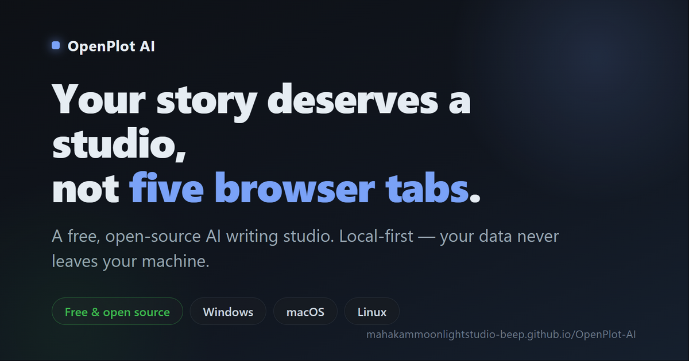
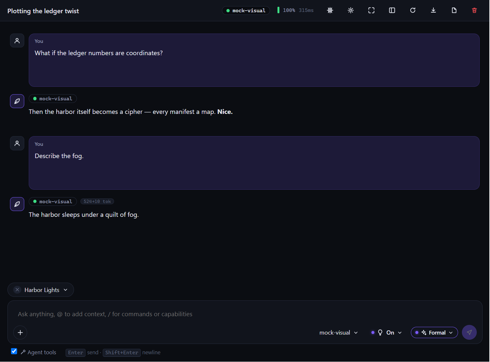
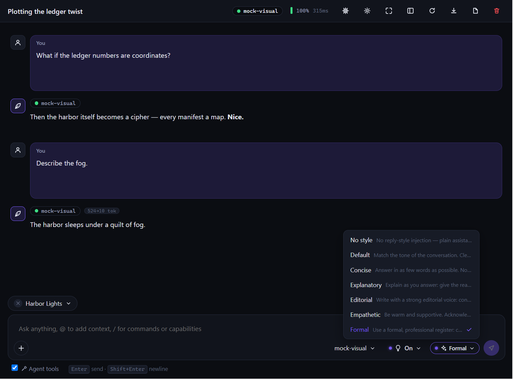
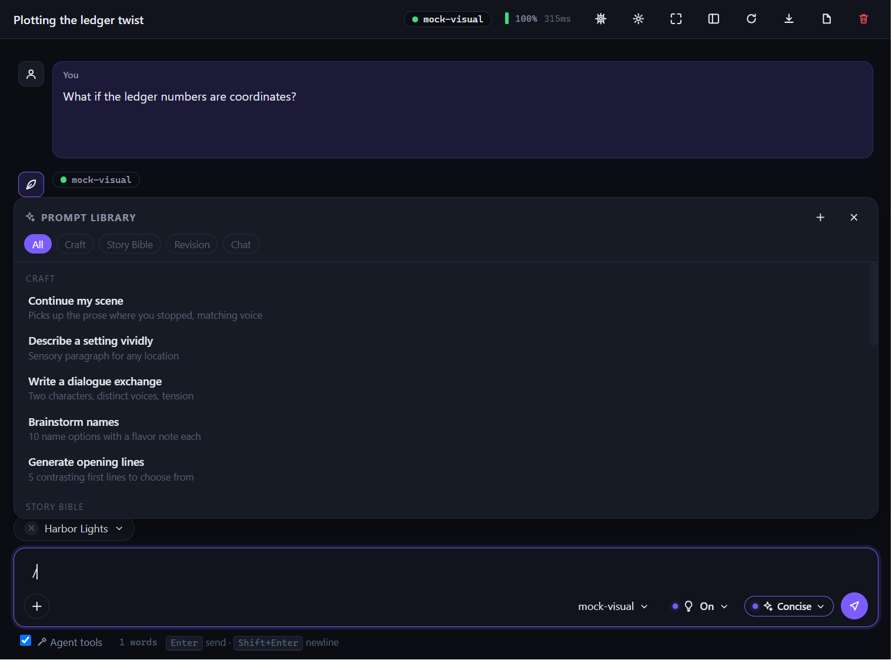
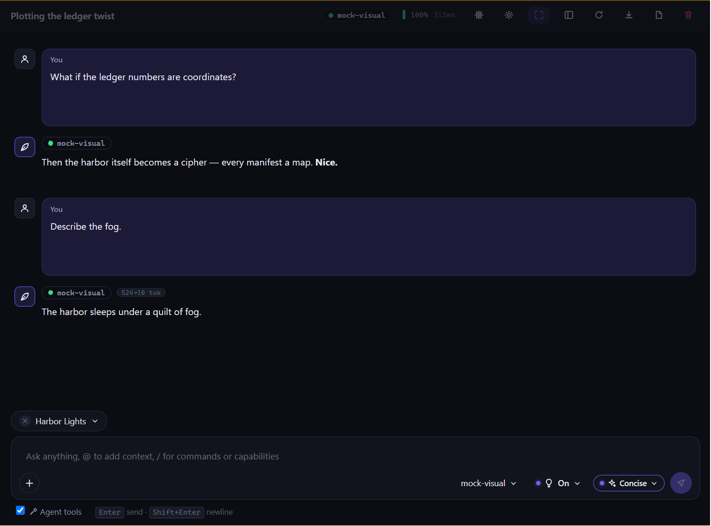
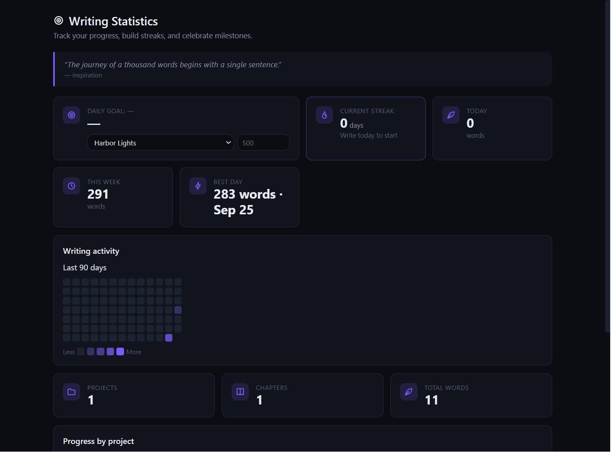
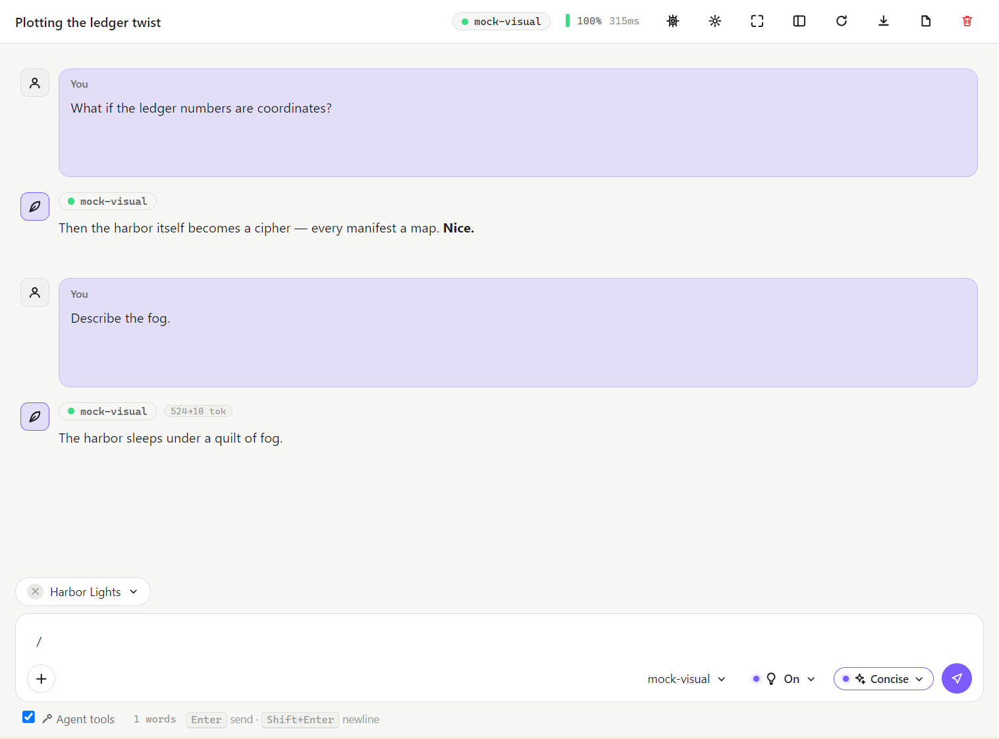

# OpenPlot AI

**Your story deserves a studio, not five browser tabs.**

A free, open-source, local-first AI writing studio for Windows, macOS and Linux. Chat with any model, keep your canon in a structured story bible, outline in three acts, write chapters, and watch your progress — all in one desktop window.

**[Download the latest release](https://github.com/mahakammoonlightstudio-beep/OpenPlot-AI/releases/latest)** · [Website](https://mahakammoonlightstudio-beep.github.io/OpenPlot-AI/) · [Changelog](CHANGELOG.md)

[](https://github.com/mahakammoonlightstudio-beep/OpenPlot-AI/releases)
[](https://github.com/mahakammoonlightstudio-beep/OpenPlot-AI/actions/workflows/ci.yml)
[](LICENSE)
[](https://github.com/mahakammoonlightstudio-beep/OpenPlot-AI/releases)




## Screenshots

_Captured from a demo workspace using a local mock provider._

<table>
  <tr>
    <td width="50%">
      
      <sub><b>Chat that stays out of the way.</b> Streaming replies, reasoning display, agent tools, per-message tokens and a model-health strip.</sub>
    </td>
    <td width="50%">
      
      <sub><b>Reply styles.</b> Choose how the assistant writes — Concise, Editorial, Empathetic, Formal — or add your own.</sub>
    </td>
  </tr>
  <tr>
    <td width="50%">
      
      <sub><b>Prompt library.</b> Type <code>/</code> for reusable prompts with placeholders, grouped by Craft, Story Bible, Revision and Chat.</sub>
    </td>
    <td width="50%">
      
      <sub><b>Zen mode.</b> Hide the chrome and slide the sidebar away for a full-width writing surface. <code>Esc</code> brings everything back.</sub>
    </td>
  </tr>
  <tr>
    <td width="50%">
      
      <sub><b>Writing statistics.</b> Daily goal, current and best streak, weekly totals, a 90-day heatmap and per-project progress.</sub>
    </td>
    <td width="50%">
      
      <sub><b>Ten themes, ten accents.</b> From dark classic to light paper, in English or Bahasa Indonesia.</sub>
    </td>
  </tr>
</table>

## Why OpenPlot AI

- **One window instead of five tabs.** Chat, story bible, outline board, chapters and statistics share the same project — no copy-pasting canon between tools.
- **Your canon is structured, not a prompt.** Worlds, locations, characters, items and lore are real records with tags, links and attached reference files. The agent can read all of it with native tools.
- **Bring your own model.** OpenAI, Anthropic, OpenRouter, Groq, Ollama, LM Studio or any OpenAI-compatible `/v1` endpoint. One provider card per service, any model per chat.
- **Local-first by design.** SQLite on your disk, API keys in the OS credential vault, no account, no cloud sync, no telemetry.

## New in 1.2.3

The “studio UX” release: a patch number on the tin, a rebuilt studio inside.

- **Files live in the chat.** Attach a file and it becomes a card with its name and size — click it to read before sending. After send the card stays in the transcript and opens the full content in a popup; it survives restarts and is deleted with its message. Stored locally with the message (8 files, 256 KB each).
- **A guide inside the app.** A bundled, searchable handbook in English and Bahasa Indonesia — chat, files, models and cache, thinking, skills, `agent.md`, the Story Bible, chapters, flow, stats, export, settings, plugins, MCP, privacy, troubleshooting, shortcuts — from the sidebar, the palette, `F1`, and the help buttons next to each setting.
- **Thinking only where it exists.** The thinking control follows the model: reasoning models show the toggle, budget, live trace and duration; models without reasoning hide it and are never sent thinking parameters; unverified ones say so.
- **Smart configuration reports cache memory.** Each model card states context, output, reasoning and prompt-cache capacity (automatic, explicit breakpoints, or unknown), plus the cached tokens the last reply actually reused. Anthropic requests send `cache_control`; OpenAI, DeepSeek and Gemini are read from provider usage.
- **Skills you enable on purpose.** Six builtin skills ship with the app and upgrade safely. A newly added skill starts **disabled** — it must be enabled before it changes a reply — and can be switched off per chat from the composer.
- **Settings that explain themselves.** Six groups instead of a wall of tabs, search across every control, a Simple/Advanced switch, guided provider setup, per-section reset, and a rewritten `agent.md` with a compiled-prompt preview and restore-to-default.
- **Lighter under load.** Versioned migrations with a pre-upgrade backup, paged transcripts (at most 200 messages in memory, with load-earlier that keeps your place), code-split views, narrow store subscriptions, byte-capped highlight cache, and teardown for every timer and listener.
- **Motion you can switch off.** Route fade, modal and toast entry, and a message-in animation for the newest bubble only — reduced-motion aware, and off in one setting.

- **Extensions that reach outside the app.** The MCP bridge now spawns the servers you enable, handshakes with them, lists their tools and lets the model call them as `mcp__{server}__{tool}` — with a live status dot, tool count, restart and a per-server log. Automations gained four triggers (message sent, chapter saved, project created, skill enabled) and new actions (flash the window, apply a skill, create a chat), plus per-row **Test**, a run history and loop guards.
- **A prompt library you can carry.** Export your prompts as JSON and import bundles from elsewhere: each entry is validated, categories normalised, duplicates skipped by title+category, and the batch capped. Any prompt can be duplicated, the insertion preview expands its first `{placeholder}` live, and each row counts how often it was used in the open chat.
- **A palette that reaches more.** `Ctrl/Cmd+K` also switches models (grouped by provider with a thinking hint), toggles skills, and runs plugin commands registered by your plugins.

## New in 1.2

- **Plot Smith — the story agent.** A four-step guided wizard: brief → three premise options → cast & world → three-act outline. Pick genre, tone, POV, length, format, audience, language and must-haves; include or exclude any character, location or lore card; then create the whole project — bible entries, chapters and flow beats — in one click. Plans are saved locally and can be reopened, and every step can be cancelled mid-generation.
- **Reference files in the Story Bible.** Attach `.md`, `.txt`, `.json` or `.csv` files to any entry with the picker or drag & drop. They stay with the entry, are searchable by name and content, and the agent can read them through `read_story_file` — no more pasting notes into prompts.
- **Bulk import.** Turn Markdown headings, JSON arrays/objects or CSV rows into Story Bible entries in one pass, with a preview, automatic category inference and duplicate-title skipping.
- **A lighter core.** Database writes happen only when something actually changed and go through a temp file + atomic rename; long chats mount only the visible window; Settings → Data shows the on-disk size and offers a safe **Compact database** action.

## Features

**Chat**
- Multi-provider, multi-model. Any model from any connected provider can be chosen per chat.
- Streaming responses with a reasoning/thinking display (Anthropic extended thinking, DeepSeek-style `reasoning`, `<think>` tags).
- **Reply styles** — builtin personas (Default, Concise, Explanatory, Editorial, Empathetic, Formal) injected as a system fragment; edit builtins or add custom styles in Settings → Styles.
- **Attachment cards** — attach files or drag them onto the chat; drag Story Bible entries and chapters straight from their views. Each attachment is a card you can read before sending, and the file stays in the transcript after send, reopening in a popup.
- **Token accounting** — prompt/completion tokens are captured from the provider when reported, estimated otherwise, and summarized per model and per chat in Settings → Usage.
- **Agent tools** — the model can save memories, read the whole story bible in one call, search entries, create/update entries, create/update/append chapters, and read projects and chapters directly. Write actions refresh the Story Bible automatically.
- **Prompt library** with `/` templates and `{placeholder}` substitution, **@-mentions** that expand entries and chapters into context, edit-and-resend, regenerate, delete and Markdown export.
- **Context guard** — the oldest turns are trimmed from the request when a chat exceeds the model context window; nothing is deleted from the transcript.
- **Pinned chats**, **Zen mode**, a hideable sidebar, and per-chat overrides for system prompt, temperature, max tokens, top-p, thinking budget, tools, memory and project binding.

**Writing**
- **Story Bible** — worlds, locations, characters, items and lore with tags, cross-links, full-text search, per-category counts, reference files and bulk import.
- **Chapters** — draft/revising/done statuses, reading-order reordering, focus mode, a scene board per chapter and version history (snapshots on save, before an AI append and before a restore; last 30 kept).
- **Story Flow** — a three-act outline board of beats that can be linked to chapters and moved between acts.
- **One-click AI actions** on the open chapter: continue writing, critique, beat outline.
- **Writing statistics** — daily goal, current and best streak, weekly totals, 90-day heatmap, per-project stakes and an AI arc analysis.
- **Skills** — Continuity Guardian, Prose Polisher, Dialogue Coach, Pacing Analyst, Beta Reader and Worldbuilding Architect ship with the app; edit, reset or delete them, add your own (new skills start disabled until enabled), and switch any skill off per chat.

**Export and organization**
- Whole-project export to Markdown, plain-text manuscript or EPUB (assembled in the main process, no external dependencies) with author and language metadata from Settings; per-chat Markdown export.
- Projects bind chats, Story Bible, chapters and statistics together; collapsible chat folders, full-text chat search and a command palette (`Ctrl/Cmd+K`).

**Extensibility**
- `agent.md` instructions injected into every chat, reply styles, skill packs, JavaScript plugins with lifecycle hooks and palette commands (they run with full Node access — install only plugins you trust), when/then automations with run history and loop guards, and an MCP bridge that runs the servers you enable. See [docs/PLUGIN_API.md](docs/PLUGIN_API.md).

**Performance and privacy**
- Database persistence is dirty-checked, atomic, and debounced; imports and Plot Smith project creation are single validated operations with one persistence pass.
- All data lives in a local SQLite database in the OS user-data directory. API keys are encrypted at rest with the OS credential vault (DPAPI, Keychain or libsecret) when available. Memories are visible and deletable in Settings, and one action clears all of them.

## Downloads

Prebuilt binaries for **v1.2.3** are attached to the [GitHub releases](https://github.com/mahakammoonlightstudio-beep/OpenPlot-AI/releases). Two packaging styles are provided for each platform:

- **Full app** — a single installer or self-contained file. Install (or run) and the app appears in the usual place for your system.
- **Folder** — a compressed archive containing the application directory. Extract it anywhere and run the binary inside; useful for portable setups and systems without installer permissions.

| Platform | Full app | Folder |
| --- | --- | --- |
| Windows | `OpenPlot.AI.Setup.1.2.3.exe` (NSIS installer) | `OpenPlot.AI-1.2.3-win.zip` |
| macOS | `OpenPlot.AI-1.2.3-universal.dmg` (universal) | `OpenPlot.AI-1.2.3-universal-mac.zip` (universal) / `OpenPlot.AI-1.2.3-arm64-mac.zip` (Apple silicon) |
| Linux | `OpenPlot.AI-1.2.3.AppImage` | `openplot-ai-1.2.3.tar.gz` |

The macOS disk image and the main macOS zip are universal binaries containing both Intel and Apple silicon builds; the `arm64-mac.zip` remains available for a smaller Apple silicon-only download. Older assets for v1.0.0, v1.0.1, v1.0.2, v1.1.0, v1.1.1, v1.2.0 and v1.2.1 stay attached to their releases.

Releases are built automatically by GitHub Actions on tagged commits.

## Building from source

Requirements: Node.js 18 or newer and npm.

```bash
npm install          # install dependencies
npm run dev          # development (Vite + Electron, hot reload)
npm run typecheck    # TypeScript, no emit
npm run build        # build renderer and main process
npm start            # run the built app
npm test             # headless test suite (DB, engine, parsers, tools)
npm run test:e2e     # + GUI end-to-end tests (boots vite + Electron)

npm run dist:win     # Windows NSIS + zip
npm run dist:linux   # Linux AppImage + tar.gz
npm run dist:mac     # macOS dmg + zip
```

DevTools do not open automatically in development; set `OPENPLOT_DEVTOOLS=1` to enable them.

## Testing

`npm test` runs every headless test in `scripts/` (mock HTTP servers + temp SQLite DB — no GUI, no network beyond localhost, no real API keys). It auto-rebuilds `dist-electron` when `electron/*.ts` is newer than the build output.

```bash
npm test                                  # headless group (~10s)
npm run test:e2e                          # headless + GUI end-to-end groups
node scripts/run-all-tests.mjs --list     # show all groups
node scripts/run-all-tests.mjs --include=e2e-attach   # + tests for a RUNNING app (:9222)
```

Groups: `headless` (DB/tools/engine/parsers plus the Story Bible import parser, the Plot Smith engine, the story-vault data layer and a server-render smoke test for every main view), `e2e-local` (boots its own Vite + Electron in an isolated profile), `e2e-attach` (drives an already-running dev app over CDP; skipped with a notice when the app isn't running), and `manual` (touches the real installed app / profile / API keys — never run automatically, only via an explicit `--include=manual`).

## Releasing

Releases are built by GitHub Actions from a version tag. The helper verifies the version and changelog at `origin/main`, creates the annotated tag and pushes it:

```bash
npm run release -- --dry-run      # preview: no tag, no push
npm run release                  # tag + push v<package.json version>
npm run release -- --verify      # inspect the draft release (requires gh)
```

It never force-pushes, never moves an existing tag and never publishes a release. The tag push triggers `.github/workflows/release.yml`; review the draft assets on GitHub, add the changelog notes and publish manually. Use `--commit <sha>` to tag a specific tested commit instead of the latest `origin/main`.

## Connecting a provider

1. Open **Settings → AI Providers → Add provider**.
2. Set the base URL:

| Provider | Base URL |
| --- | --- |
| OpenAI | `https://api.openai.com/v1` |
| Anthropic | `https://api.anthropic.com/v1` |
| OpenRouter | `https://openrouter.ai/api/v1` |
| Ollama | `http://localhost:11434/v1` |
| LM Studio | `http://localhost:1234/v1` |
| Groq | `https://api.groq.com/openai/v1` |

3. Paste the API key, run **Fetch models**, then select a model in the chat header.

Ollama and LM Studio need no API key. The key validator treats a `404 model not found` response from the model list as a valid key, so hosted gateways that reject probe models are handled correctly.

## Keyboard shortcuts

| Shortcut | Action |
| --- | --- |
| `Ctrl/Cmd+N` | New chat |
| `Ctrl/Cmd+Shift+N` | New project |
| `Ctrl/Cmd+S` | Save the open chapter |
| `Ctrl/Cmd+K` | Command palette |
| `Ctrl/Cmd+,` | Settings |
| `Escape` | Exit focus mode / close menus |

## Data and privacy

The database is stored at the OS user-data path (`%APPDATA%/openplot-ai` on Windows, `~/Library/Application Support/openplot-ai` on macOS, `~/.config/openplot-ai` on Linux). Uninstalling the application does not remove the database. **Settings → Data** can reset everything, including memories, story content and chapters.

## Project structure

```
electron/          main process: database, AI engine, tools, plugins, IPC
src/               React renderer
  components/      ChatView, StoryAgentView, StoryBibleView, ChaptersView, SettingsView, ...
  lib/             pure testable logic: Plot Smith engine, Story Bible import, data helpers
  styles/          ordered CSS partials (agent + feature styles included)
docs/              plugin API reference, stress test notes, original README, screenshots
scripts/           headless, UI-render, GUI and end-to-end test scripts
```

## Documentation

- [Changelog](CHANGELOG.md)
- [Plugin API](docs/PLUGIN_API.md)
- [Stress test notes](docs/STRESS_TEST.md)
- [Original README variant](docs/README-original.md)

## License

[MIT](LICENSE) — Mahakam Moonlight Studio.

## Support

Development is funded through [SociaBuzz](https://sociabuzz.com/mahakam_moonlight_studio/tribe) and [Saweria](https://saweria.co/MahakamMoonStudio).
