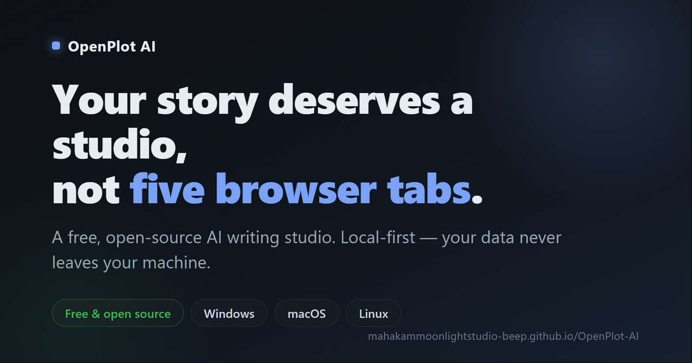
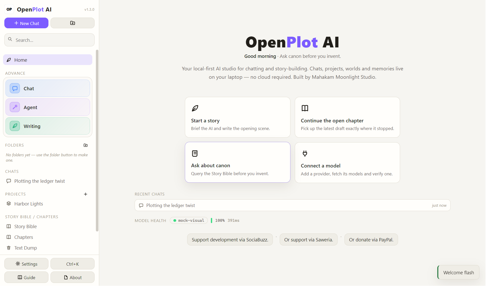
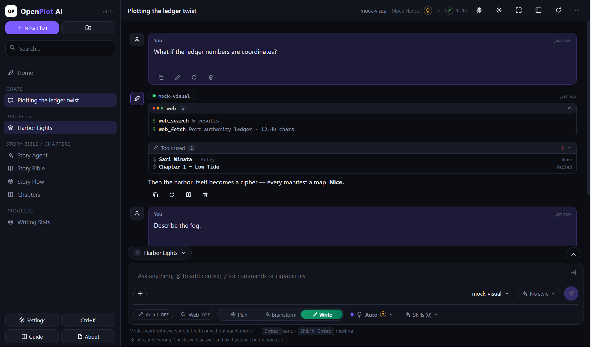
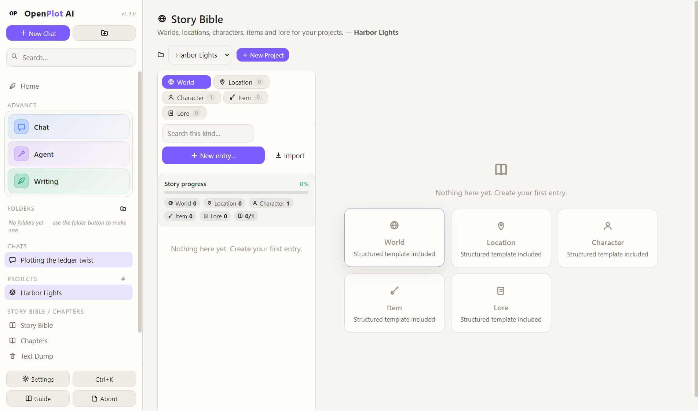
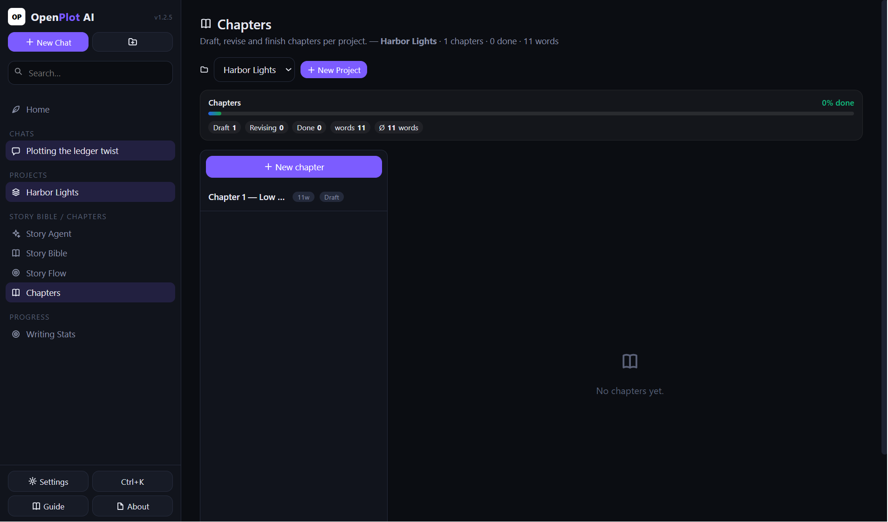
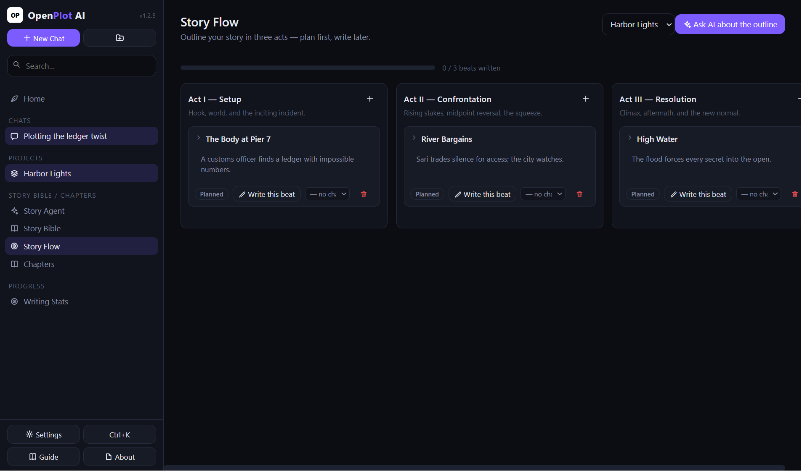
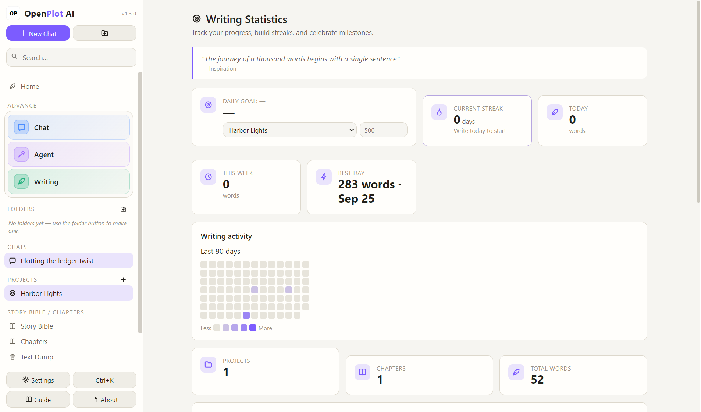
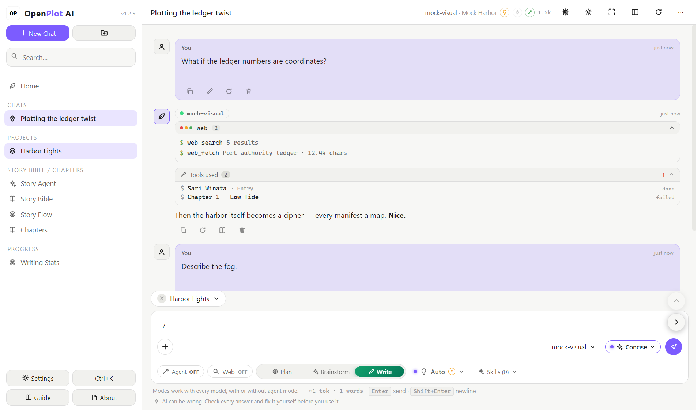

<div align="center">



# OpenPlot AI

**Your story deserves a studio, not five browser tabs.**

A free, open-source, local-first AI writing studio for Windows, macOS and Linux.
Chat with any model, keep your canon in a structured story bible, outline in
three acts, write chapters, and watch the book grow — in one desktop window.

[**Download the latest release**](https://github.com/mahakammoonlightstudio-beep/OpenPlot-AI/releases/latest) ·
[Website](https://mahakammoonlightstudio-beep.github.io/OpenPlot-AI/) ·
[Changelog](CHANGELOG.md) ·
[Security](SECURITY.md) ·
[Contributing](CONTRIBUTING.md)

[](https://github.com/mahakammoonlightstudio-beep/OpenPlot-AI/releases)
[](https://github.com/mahakammoonlightstudio-beep/OpenPlot-AI/actions/workflows/ci.yml)
[](LICENSE)
[](https://github.com/mahakammoonlightstudio-beep/OpenPlot-AI/releases)


</div>

---

## The room where the book happens

Most AI writing tools give you a chat box and hope. OpenPlot AI gives the model
your actual story — and gives you the room to shape it.

| | |
| --- | --- |
| **One window, one project** | Chat, story bible, outline board, chapters and statistics share the same project. No copy-pasting canon between tabs, no “which doc has the latest version?” |
| **Canon that is data, not a prompt** | Worlds, locations, characters, items and lore are real records with tags, links and reference files. The agent reads all of it with native tools. |
| **The model you already pay for** | OpenAI, Anthropic, OpenRouter, Groq, Ollama, LM Studio, or any OpenAI-compatible `/v1` endpoint. One provider card per service, any model per chat. |
| **Local by default** | SQLite on your disk, keys in the OS credential vault, no account, no cloud sync, no telemetry. The renderer cannot even open a socket. |

## Screenshots

_Captured from a demo workspace using a local mock provider._

<table>
  <tr>
    <td colspan="2">
      
      <sub><b>Home first.</b> A greeting that follows the clock, four quick starts, recent chats and the live model-health strip.</sub>
    </td>
  </tr>
  <tr>
    <td width="50%">
      
      <sub><b>Chat that stays out of the way.</b> Streaming replies, reasoning display, agent tools, per-message tokens and model health.</sub>
    </td>
    <td width="50%">
      
      <sub><b>Canon you can browse.</b> Structured Story Bible entries with tags, links and attached reference files.</sub>
    </td>
  </tr>
  <tr>
    <td width="50%">
      
      <sub><b>Write where the book lives.</b> Draft, revise and finish chapters with version history and a scene board.</sub>
    </td>
    <td width="50%">
      
      <sub><b>The shape of the story.</b> A three-act board of beats you can link to chapters and move between acts.</sub>
    </td>
  </tr>
  <tr>
    <td width="50%">
      
      <sub><b>Progress you can see.</b> Daily goal, streaks, weekly totals, a 90-day heatmap and per-project progress.</sub>
    </td>
    <td width="50%">
      
      <sub><b>Thirteen themes, ten accents.</b> From dark classic to light paper, in English or Bahasa Indonesia.</sub>
    </td>
  </tr>
</table>

## New in 1.2.5

The “quiet studio” patch: the app opens on Home, tools stop pushing the answer
around, and the two switches people asked for finally behave the way they look.

- **Home instead of your last chat.** A greeting that follows the clock, recent
  chats, quick starts and the model-health strip — with `Home` in the sidebar.
- **Web research without agent mode.** A **Web** switch gives the open chat
  `web_search` and `web_fetch`, in their own terminal-style panel.
- **A tool log that stays out of the way.** One collapsed row
  (`Tools used · 4`) that expands into readable steps, folds itself when the run
  ends, and is stored with the reply so a reopened chat still explains it.
- **Canon in plain chats.** A project-bound chat receives its Story Bible even
  with agent mode off.
- **Every approval in one place.** Settings → Plugins/MCP lists the plugin and
  MCP approvals you have given, marks approvals whose code or command changed,
  marks rows that were deleted, and revokes one instantly. Approval is still per
  exact payload: edit the code and the app asks again.
- **Remote images, without the renderer.** Markdown images are fetched by the
  main process — public http(s) hosts only, no credentials, redirects
  re-checked, raster only, 5 MB / 15 s cap — and handed to the page as `data:`
  URLs. The window itself still has `connect-src 'none'`.
- **A dialog you can actually dismiss.** Focus moves into a dialog on commit, a
  background editor can no longer steal it, and the first `Escape` closes it.
- **Controls you recognise.** Plan / Brainstorm / Write each keep one fixed
  colour across themes; version arrows moved below the bubble; three new themes
  (Gruvbox, Catppuccin, Sandstone).
- **Validate stops eating keys.** Pressing *Validate key* no longer reverts the
  API key input to the stored value.

[Full changelog →](CHANGELOG.md)

## What the studio does

### Chat

- **Multi-provider, multi-model.** Pick a different model for every chat, with
  streaming replies, reasoning traces, per-message tokens and a model-health
  strip.
- **Reply styles.** Builtin personas (Default, Concise, Explanatory, Editorial,
  Empathetic, Formal) or your own, injected as a system fragment.
- **Agent tools.** The model can read the whole Story Bible in one call, search
  entries, create or update canon, write and append chapters, and save
  memories — with write actions refreshing the Bible immediately.
- **A prompt library.** `/` templates with `{placeholders}`, `@`-mentions that
  expand entries and chapters into context, edit-and-resend, regenerate,
  delete, and Markdown export.
- **Files in the chat.** Attach up to 8 files per message; they become cards
  you can read before sending, stay in the transcript, and open in a popup
  after a restart.
- **Context guard.** Old turns are trimmed from the request when a chat exceeds
  the model's window; nothing is deleted from the transcript.

### Canon and writing

- **Story Bible** — worlds, locations, characters, items and lore with tags,
  cross-links, full-text search, per-category counts, reference files and bulk
  import from Markdown, JSON or CSV.
- **Chapters** — draft / revising / done, reading-order reordering, focus mode,
  a scene board, and version history (snapshots on save, before an AI append
  and before a restore; the last 30 are kept).
- **Story Flow** — a three-act board of beats linked to chapters.
- **Plot Smith** — a guided four-step story agent (brief → premises → cast &
  world → three-act outline) that can create the whole project in one click.
- **Writing statistics** — daily goal, current and best streak, weekly totals, a
  90-day heatmap, per-project stakes and an AI arc analysis.

### Extensions — with a gate

- **Skills.** Six builtin skills (Continuity Guardian, Prose Polisher, Dialogue
  Coach, Pacing Analyst, Beta Reader, Worldbuilding Architect) plus your own.
  A new skill starts disabled; switch any skill off per chat.
- **Plugins.** JavaScript lifecycle hooks and palette commands, with full Node
  access. They run only after you approve that exact code.
- **MCP bridge.** Enabled stdio servers are spawned, handshaken, listed and
  callable as `mcp__{server}__{tool}`, with status, restart and logs. An MCP
  definition is an arbitrary local command — it runs only after approval.
- **Automations.** Seven triggers and nine actions with per-row **Test**, a run
  history and loop guards.

## Bring your own model

| Provider | Base URL |
| --- | --- |
| OpenAI | `https://api.openai.com/v1` |
| Anthropic | `https://api.anthropic.com/v1` |
| OpenRouter | `https://openrouter.ai/api/v1` |
| Groq | `https://api.groq.com/openai/v1` |
| Ollama | `http://localhost:11434/v1` |
| LM Studio | `http://localhost:1234/v1` |

Open **Settings → AI Providers → Add provider**, paste the key, run **Fetch
models**, then choose a model in the chat header. Ollama and LM Studio need no
key. A `404 model not found` from the model list still counts as a valid key, so
hosted gateways that reject probe models work too.

## Install

Prebuilt binaries for **v1.2.5** are attached to the
[GitHub releases](https://github.com/mahakammoonlightstudio-beep/OpenPlot-AI/releases).
Each platform has a full installer/app and a portable folder build.

| Platform | Full app | Folder |
| --- | --- | --- |
| Windows | `OpenPlot.AI.Setup.1.2.5.exe` (NSIS installer) | `OpenPlot.AI-1.2.5-win.zip` |
| macOS | `OpenPlot.AI-1.2.5-universal.dmg` (universal) | `OpenPlot.AI-1.2.5-universal-mac.zip` / `OpenPlot.AI-1.2.5-arm64-mac.zip` |
| Linux | `OpenPlot.AI-1.2.5.AppImage` | `openplot-ai-1.2.5.tar.gz` |

The macOS disk image and the main macOS zip are universal (Intel + Apple
silicon); the `arm64-mac.zip` is smaller and Apple-silicon only.

## Build from source

Requirements: **Node.js 18+** and npm.

```bash
npm install          # install dependencies
npm run dev          # Vite + Electron, hot reload
npm run typecheck    # TypeScript, no emit
npm run build        # renderer bundle + main-process compile
npm start            # run the built app
npm test             # headless suite
npm run test:e2e     # headless + GUI end-to-end

npm run dist:win     # Windows NSIS + zip
npm run dist:linux   # Linux x64 AppImage + tar.gz
npm run dist:mac     # macOS dmg + zip
```

The release workflow also cross-builds Linux **arm64** AppImage and tarball
(`OpenPlot.AI-<version>-arm64.*`); `npm run dist:linux` locally stays x64.

macOS builds are signed with the hardened runtime and notarized automatically
when the repository has `MAC_CERT_P12`, `MAC_CERT_PASSWORD`, `APPLE_ID`,
`APPLE_APP_SPECIFIC_PASSWORD` and `APPLE_TEAM_ID` secrets. Without them the
macOS build is unsigned and Gatekeeper asks you to open it once.

DevTools stay closed in development; set `OPENPLOT_DEVTOOLS=1` to open them.

## Tests

`npm test` runs the headless group — mock HTTP servers and temp SQLite
databases, no GUI, no real keys. It rebuilds `dist-electron` when
`electron/*.ts` is newer than the build output.

```bash
npm test                                  # headless (~2 min)
npm run test:e2e                          # + Vite/Electron GUI groups
node scripts/run-all-tests.mjs --list     # list every group
node scripts/run-all-tests.mjs --include=e2e-attach   # drive a RUNNING app (:9222)
```

| Group | What it covers |
| --- | --- |
| `headless` | DB and migrations, engine and parsers, tools, prompt assembly, guide, MCP, security, approvals, perf and bundle budgets, fuzz |
| `e2e-local` | boots its own Vite + Electron in an isolated profile: chat/tools/prompts, keyboard focus, studio UX, hostile-markdown XSS |
| `e2e-attach` | drives an already-running dev app over CDP (skipped when it is not running) |
| `manual` | real installed app / real profile / packaged build; only with an explicit flag |

## Project map

```text
electron/          main process: database, providers, tools, plugins, MCP,
                   files, images, approvals, IPC
src/               React renderer
  components/      one file per view + chat/ and settings/ subfolders
  lib/             pure testable logic (prompt, imports, paging, progress)
  guide/           bundled English + Indonesian handbook
  styles/          ordered CSS partials
scripts/           headless, UI-render, GUI and end-to-end tests
docs/              plugin API, handbook, stress notes, showcase screenshots
```

Every file, what it owns, and the invariants that keep it safe are listed in
[CONTRIBUTING.md](CONTRIBUTING.md#file-map). Read that before renaming or moving
something under `electron/`.

## Privacy and security

OpenPlot AI stores its database in the OS user-data path
(`%APPDATA%/openplot-ai` on Windows, `~/Library/Application Support/openplot-ai`
on macOS, `~/.config/openplot-ai` on Linux). Uninstalling does not delete it;
**Settings → Data** can reset everything, including memories and chapters.

API keys are encrypted at rest with the OS credential vault when available
(DPAPI, Keychain or libsecret). There is no account, no analytics and no
background update ping. Attachments are read only through grants, `web_fetch`
refuses your own network, and plugins/MCP run only after explicit approval.

The full threat model, scope, hardening details and disclosure timeline are in
[**SECURITY.md**](SECURITY.md). To report a vulnerability, email
[mr.fauzan121314@gmail.com](mailto:mr.fauzan121314@gmail.com) — please do not
open a public issue.

## Documentation

- [Security policy](SECURITY.md)
- [Contributing and file map](CONTRIBUTING.md)
- [Changelog](CHANGELOG.md)
- [Plugin API](docs/PLUGIN_API.md)
- [Handbook](docs/HANDBOOK.md) · [Panduan (ID)](docs/HANDBOOK.id.md)
- [Stress test notes](docs/STRESS_TEST.md)

## License

[MIT](LICENSE) — Mahakam Moonlight Studio.

## Support

Development is funded through
[SociaBuzz](https://sociabuzz.com/mahakam_moonlight_studio/tribe) and
[Saweria](https://saweria.co/MahakamMoonStudio). Starring the repo, filing a
clear bug report and telling another writer about it help just as much.
